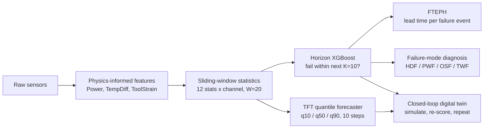
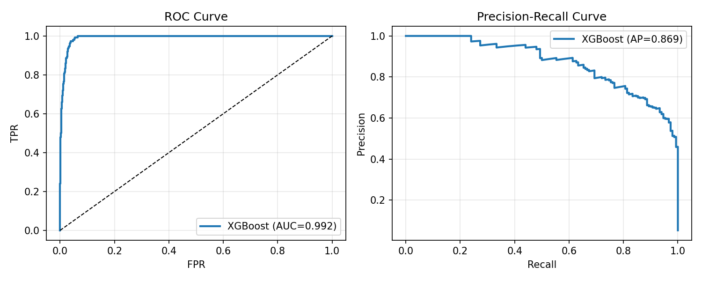

<div align="center">

# IoT-DriftGen

### Predictive maintenance that tells you *how early* it warns, not just whether it's right.

Horizon-based failure early warning + a generative digital twin for industrial IoT.
Built for the **IEEE IES Generative AI Challenge 2026**.


</div>

---

## The finding in one table

Most predictive-maintenance papers report one number: classification AUC on a random split. We tested what happens when you remove window-overlap leakage.

| | Stratified split | Chronological split | Change |
|---|---|---|---|
| **ROC-AUC** (AI4I) | 0.992 | 0.767 | **-22 points** |
| **F1** (AI4I) | 0.925 | 0.518 | **-41 points** |
| **Mean lead time, FTEPH** (AI4I) | 33.2 cycles | 33.0 cycles | **-0.2 cycles** |
| **Mean lead time, FTEPH** (CMAPSS) | 46.2 cycles | 46.5 cycles | **+0.3 cycles** |

The accuracy score collapses, but the thing a maintenance team actually acts on (how many cycles of warning they get before each failure) does not. That dissociation is the core contribution, and it is why we introduce **FTEPH** (Failure-Type Early Prediction Horizon), an event-level metric that should sit next to AUC in any PdM evaluation.

> On held-out CMAPSS engines the system gives a **46.5-cycle mean warning**, with **95% of 66 failure events caught at least 20 cycles ahead**.

---

## How it works



**1. Horizon labels, not instant labels.** Instead of asking "is the machine failing now?", the target is "will it fail within the next 10 cycles?". It needs only failure timestamps, so it works on abrupt failures (AI4I) and smooth degradation (CMAPSS) with the same pipeline.

**2. Temporal features do the heavy lifting.** Removing the sliding-window statistics costs 0.117 AUC. Removing the physics features costs 0.009. Early signatures live in slopes and variance, not in raw sensor values.

**3. A forecaster that knows what it doesn't know.** A compact TFT-inspired model (509,636 parameters, failure-type embedding, pinball loss, manifold mixup) predicts the next 10 steps with uncertainty bands.

**4. A digital twin with a falsification test.** Seed with a pre-failure window, roll the forecaster forward, and re-score each step with the independent detector. Seed with *healthy* windows and the risk should stay low. We report where that holds and where it doesn't.

---

## Results

### Detection (chronological = the realistic column)

| | AI4I 2020 | CMAPSS FD001 |
|---|---|---|
| ROC-AUC | 0.767 | **0.992** |
| Average precision | 0.380 | 0.870 |
| F1 | 0.518 | 0.770 |
| FTEPH, mean lead time | 33.0 cycles | **46.5 cycles** |
| Events caught with ≥20 cycles of warning | 68% | **95%** |

Five-seed robustness on AI4I (stratified, full Optuna sweep per seed): ROC-AUC **0.9868 ± 0.0052** (95% CI).

### Forecasting vs. trivial baselines (chronological)

| Dataset | TFT RMSE | vs. persistence | vs. moving average | 80% band coverage |
|---|---|---|---|---|
| AI4I | 0.137 | **-27.3%** | **-20.6%** | 86.5% |
| CMAPSS FD001 | 0.128 | **-36.8%** | **-27.1%** | 78.2% |

The gain holds across all four AI4I failure types, and the rarest one (TWF, n=49) gains the most in absolute RMSE.

### Digital twin consistency

| Failure type | Consistency |
|---|---|
| AI4I PWF | 0.232 |
| AI4I TWF | 0.315 |
| AI4I OSF | 0.422 |
| CMAPSS | 0.425 |

Consistency = how far a simulated trajectory moves from the healthy baseline toward certain failure, scored by a detector that never shared parameters with the generator. Healthy-seed drift varies from 0.069 (TWF) to 0.236 (HDF) across failure types, which shows the conditioning input is actually used.





---

## What we didn't hide

A good evaluation lists its weak spots. Ours:

- **AI4I has no real time axis.** Its "chronological" split is a row-order proxy, so read 0.767 AUC as a lower bound. CMAPSS uses an engine-level split and is the genuinely held-out test.
- **The stratified AI4I numbers are inflated.** Windows sharing 19 of 20 rows landed on both sides of the split. We keep that run only to reproduce the original protocol.
- **No HDF seed qualified** for the AI4I closed loop, so HDF is not validated there. We report the gap instead of relaxing the seed criterion.
- **The CMAPSS healthy-seed control is uninformative.** One failure class means the conditioning signal is constant.
- **Chronological diagnosis degenerates on AI4I** (no HDF in the test set, TWF never predicted), so per-class scores matter more than macro-F1.
- **Consistency scores stay below 0.5**, which reflects the smoothing of q50 forecasting.
- Validated on public benchmarks only. Real deployment needs calibration on real plant data.

---

## Quickstart

```bash
git clone https://github.com/<your-username>/iot-driftgen.git
cd iot-driftgen
pip install -r requirements.txt
# download AI4I 2020 and C-MAPSS FD001 into ./data
jupyter lab notebooks/
```

Set `SPLIT_MODE = "chrono"` at the top of each notebook for the headline results. Seeds are fixed for NumPy, PyTorch and Python's `random`.


## Team

Imene Ait Abdellah · Soumia Bouaouina · Imene Fatma Cheboui · Douaa Djaid · Yasmina Medjri
National School of Artificial Intelligence (ENSIA), Algiers

Thanks to the IEEE Industrial Electronics Society and the Generative AI Hackathon organisers, Daswin De Silva and Lakshitha Gunasekara.

## Citation

```bibtex
@misc{iotdriftgen2026,
  title  = {IoT-DriftGen: Horizon-Based Early Warning for Predictive Maintenance with Drift-Aware Temporal Evaluation},
  author = {Ait Abdellah, Imene and Bouaouina, Soumia and Cheboui, Imene Fatma and Djaid, Douaa and Medjri, Yasmina},
  year   = {2026}
}
```
