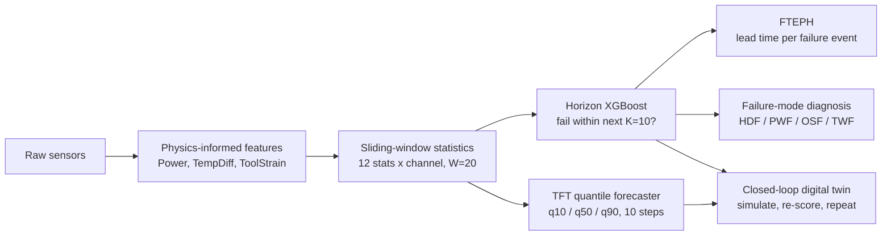
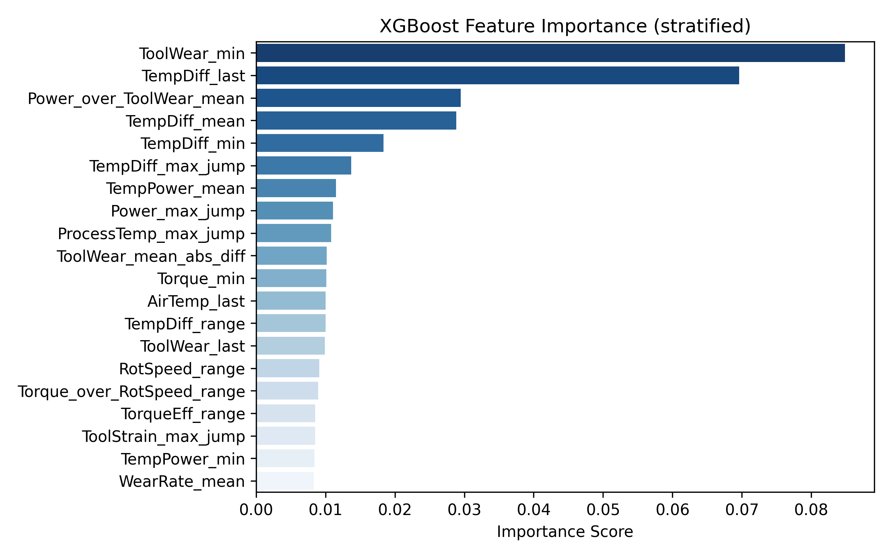
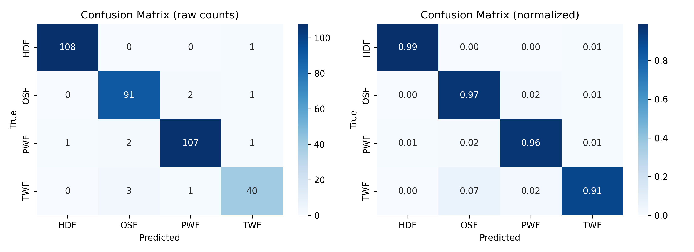

<div align="center">

# IoT-DriftGen

### Predictive maintenance that tells you *how early* it warns, not just whether it's right.

Horizon-based failure early warning + a generative digital twin for industrial IoT.
Built for the **IEEE IES Generative AI Challenge 2026**.


</div>

---

## Research gap

Predictive-maintenance results are hard to trust and hard to act on, for three reasons:

1. **Detection is defined at the wrong moment.** Most methods ask "is the machine failing *now*?", which leaves maintenance teams almost no lead time. RUL regression needs precise degradation labels that industrial sites rarely have.
2. **Reconstruction-based detectors miss abrupt failures.** On datasets like AI4I 2020, failures are point-like and preceded by nominal sensor values, so anomaly scores cannot rise before the failure happens.
3. **Random stratified evaluation leaks.** Sliding windows from the same stream land on both sides of the split, so reported AUC can reflect memorised neighbours rather than generalisation. Almost no PdM work reports lead time per failure event, so there is no way to tell whether a headline score survives an honest split.

## Objective

Build a horizon-based early-warning framework for industrial IoT, together with an event-level lead-time metric (FTEPH), and test whether its operational value holds up under both leaky (stratified) and leak-free (chronological) evaluation.

---

## Stratified vs. chronological: the central result

We ran the identical pipeline under two evaluation protocols on two benchmarks.

| | Stratified | Chronological |
|---|---|---|
| **Purpose** | Standard practice, kept as a reproducibility baseline | Deployment-realistic proxy |
| **AI4I 2020** | Random 70/15/15 split, seed 42 | Windows sorted in row order, 70/15/15, with a K=10 gap buffer between partitions |
| **CMAPSS FD001** | Random 70/15/15 split | Engine-level: engines 1-70 train, 71-85 validation, 86-100 test; scaler fit on training engines only |
| **Leakage risk** | High: neighbouring windows share 19 of 20 rows across train and test | Removed on AI4I; test engines are fully unseen on CMAPSS |

| Metric | AI4I strat. | AI4I chrono | CMAPSS strat. | CMAPSS chrono |
|---|---|---|---|---|
| ROC-AUC | 0.992 | 0.767 | 0.999 | 0.992 |
| Average precision | 0.973 | 0.380 | 0.985 | 0.870 |
| F1 | 0.925 | 0.518 | 0.944 | 0.770 |
| **FTEPH, mean lead time (cycles)** | **33.2** | **33.0** | **46.2** | **46.5** |
| Events caught with ≥5 cycles of warning | 100% | 99% | 100% | 100% |
| Events caught with ≥20 cycles of warning | 67% | 68% | 95% | 95% |
| TFT forecast RMSE | 0.137 | 0.137 | 0.126 | 0.128 |

**What this shows**

- **AI4I:** removing leakage costs **22 AUC points and 41 F1 points**. The stratified score was largely the model recognising windows it had already seen.
- **CMAPSS:** the same change costs only 0.7 AUC points, because engines are independent. The remaining F1 drop is genuine domain shift to unseen engines.
- **FTEPH barely moves on either dataset** (0.2 and 0.3 cycles). The warning a maintenance team gets is robust to the evaluation protocol, while window-level accuracy is not.
- **Forecasting is unaffected**, since the forecaster optimises a per-window loss with no label leakage path.

**Caveat:** AI4I has no true time axis, so its chronological result is a row-order proxy and should be read as a lower bound. CMAPSS, with its engine-level split, is the genuinely held-out test: **46.5-cycle mean warning, 95% of 66 failure events caught at least 20 cycles ahead.**

---

## How it works



**1. Horizon labels, not instant labels.** Instead of asking "is the machine failing now?", the target is "will it fail within the next 10 cycles?". It needs only failure timestamps, so it works on abrupt failures (AI4I) and smooth degradation (CMAPSS) with the same pipeline.

**2. Temporal features do the heavy lifting.** Removing the sliding-window statistics costs 0.117 AUC. Removing the physics features costs 0.009. Early signatures live in slopes and variance, not in raw sensor values.

**3. A forecaster that knows what it doesn't know.** A compact TFT-inspired model (509,636 parameters, failure-type embedding, pinball loss, manifold mixup) predicts the next 10 steps with uncertainty bands.

**4. A digital twin with a falsification test.** Seed with a pre-failure window, roll the forecaster forward, and re-score each step with the independent detector. Seed with *healthy* windows and the risk should stay low. We report where that holds and where it doesn't.

---

## Results

### Detection (chronological = the realistic column)

| | AI4I 2020 | CMAPSS FD001 |
|---|---|---|
| ROC-AUC | 0.767 | **0.992** |
| Average precision | 0.380 | 0.870 |
| F1 | 0.518 | 0.770 |
| FTEPH, mean lead time | 33.0 cycles | **46.5 cycles** |
| Events caught with ≥20 cycles of warning | 68% | **95%** |

Five-seed robustness on AI4I (stratified, full Optuna sweep per seed): ROC-AUC **0.9868 ± 0.0052** (95% CI).

### Forecasting vs. trivial baselines (chronological)

| Dataset | TFT RMSE | vs. persistence | vs. moving average | 80% band coverage |
|---|---|---|---|---|
| AI4I | 0.137 | **-27.3%** | **-20.6%** | 86.5% |
| CMAPSS FD001 | 0.128 | **-36.8%** | **-27.1%** | 78.2% |

The gain holds across all four AI4I failure types, and the rarest one (TWF, n=49) gains the most in absolute RMSE.

### Digital twin consistency

| Failure type | Consistency |
|---|---|
| AI4I PWF | 0.232 |
| AI4I TWF | 0.315 |
| AI4I OSF | 0.422 |
| CMAPSS | 0.425 |

Consistency = how far a simulated trajectory moves from the healthy baseline toward certain failure, scored by a detector that never shared parameters with the generator. Healthy-seed drift varies from 0.069 (TWF) to 0.236 (HDF) across failure types, which shows the conditioning input is actually used.


<p align="center">
  <br>
  <em>FTEPH: fraction of failure events detected at each minimum lead time.</em>
</p>


<p align="center">
  <br>
  <em>Closed-loop digital twin: healthy seeds stay below threshold, pre-failure seeds cross it.</em>
</p>

<p align="center">
  <br>
  <em> Closed-loop twin, stratified run: healthy-seed control (left) and pre-failure seeds per failure type. Seeds start near risk 1.0, so the estimated time-to-failure of 1 step is a property of the seed, not of the dynamics.</em>
</p>

<details>
<summary><b>Stratified-split artifacts (AI4I): reproducibility check only</b></summary>

<br>

These figures come from the original stratified protocol. They are kept so the first implementation can be reproduced, **not as evidence of deployment performance**: the stratified split lets near-identical windows appear in train and test, which inflates the detection and digital-twin numbers (see the chronological comparison above).


<p align="center">
  <br>
  <em>Failure-mode diagnosis (HDF / OSF / PWF / TWF), AI4I stratified. TWF is the hardest class (0.91 recall), with most errors going to OSF.</em>
</p>


<p align="center">
  <br>
  <em>The same risk trajectories, one panel per failure type.</em>
</p>

<p align="center">
  <br>
  <em>TFT-generated q50 sensor trajectories (ToolWear, TempDiff, Power, ToolStrain) per failure type.</em>
</p>

</details>

---

## What we didn't hide

A good evaluation lists its weak spots. Ours:

- **AI4I has no real time axis.** Its "chronological" split is a row-order proxy, so read 0.767 AUC as a lower bound. CMAPSS uses an engine-level split and is the genuinely held-out test.
- **The stratified AI4I numbers are inflated.** Windows sharing 19 of 20 rows landed on both sides of the split. We keep that run only to reproduce the original protocol.
- **No HDF seed qualified** for the AI4I closed loop, so HDF is not validated there. We report the gap instead of relaxing the seed criterion.
- **The CMAPSS healthy-seed control is uninformative.** One failure class means the conditioning signal is constant.
- **Chronological diagnosis degenerates on AI4I** (no HDF in the test set, TWF never predicted), so per-class scores matter more than macro-F1.
- **Consistency scores stay below 0.5**, which reflects the smoothing of q50 forecasting.
- Validated on public benchmarks only. Real deployment needs calibration on real plant data.

---

## Quickstart

```bash
git clone https://github.com/<your-username>/iot-driftgen.git
cd iot-driftgen
pip install -r requirements.txt
# download AI4I 2020 and C-MAPSS FD001 into ./data
jupyter lab notebooks/
```

Set `SPLIT_MODE = "chrono"` at the top of each notebook for the headline results. Seeds are fixed for NumPy, PyTorch and Python's `random`.

## Repository layout

```
iot-driftgen/
├── notebooks/
│   ├── 01_ai4i_chrono.ipynb
│   ├── 02_ai4i_stratified.ipynb       # reproducibility check only
│   └── 03_cmapss_fd001_chrono.ipynb
├── docs/                              # ablation study, forecasting validation, stratified-leakage note
├── results/                           # JSON exports and figures
├── paper/                             # manuscript PDF
└── data/                              # not tracked
```

## Team

Imene Ait Abdellah · Soumia Bouaouina · Imene Fatma Cheboui · Douaa Djaid · Yasmina Medjri
National School of Artificial Intelligence (ENSIA), Algiers

Thanks to the IEEE Industrial Electronics Society and the Generative AI Hackathon organisers, Daswin De Silva and Lakshitha Gunasekara.

## Citation

```bibtex
@misc{iotdriftgen2026,
  title  = {IoT-DriftGen: Horizon-Based Early Warning for Predictive Maintenance with Drift-Aware Temporal Evaluation},
  author = {Ait Abdellah, Imene and Bouaouina, Soumia and Cheboui, Imene Fatma and Djaid, Douaa and Medjri, Yasmina},
  year   = {2026}
}
```
